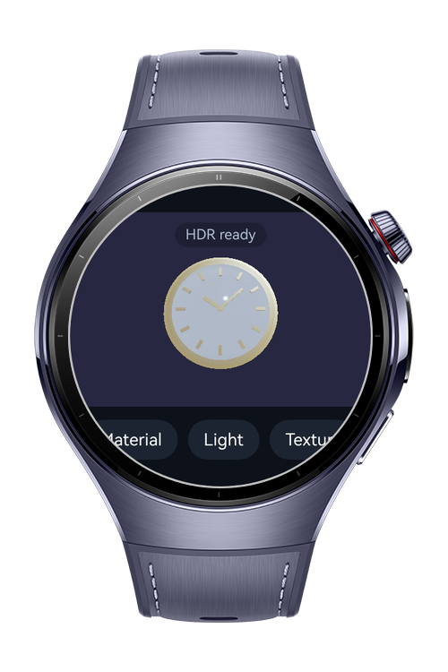
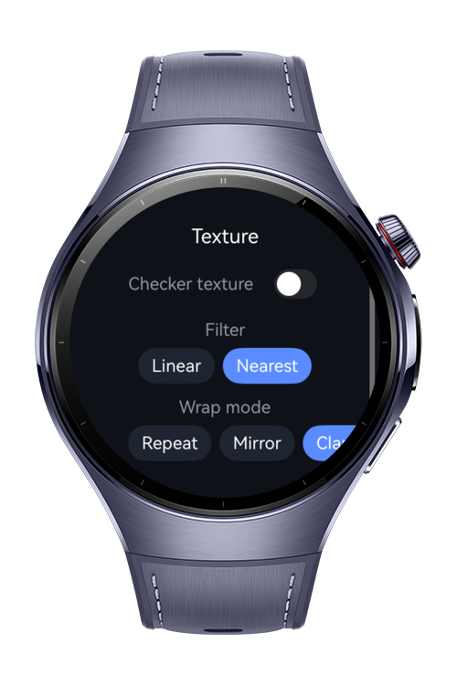
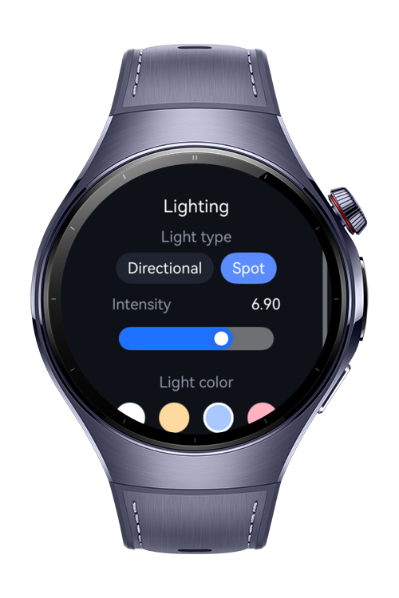
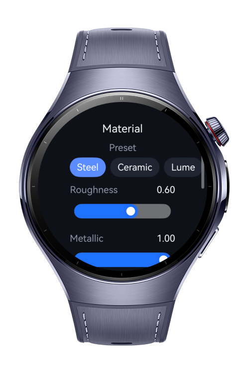

> **Note:** To access all shared projects, get information about environment setup, and view other guides, please visit [Explore-In-HMOS-Wearable Index](https://github.com/Explore-In-HMOS-Wearable/hmos-index).

# How To Build 3D Material Lighting

**How To Build 3D Material Lighting** is a HarmonyOS wearable codelab that turns a watch face into a small 3D
material and lighting studio. The sample builds a procedural 3D watch dial with ArkGraphics3D, then lets the user
tune PBR material parameters, switch light types, and compare texture sampling modes in real time.

Developers can reuse the `how-to-build-3d-material-lighting` project to learn scene setup, metallic-roughness
materials, alpha blending, back-face culling, spot lighting, sampler configuration, and HDR capability detection.

# Preview

<div>
  
  
  
  
</div>

# Use Cases

- **Material tuning:** Switch dial presets and adjust roughness, metallic, and emissive lume strength on a live 3D dial.
- **Lighting comparison:** Toggle between a directional key light and a focused spot light aimed at the dial center.
- **Texture sampling:** Apply a checker texture and compare nearest/linear filtering with repeat, mirror, and clamp wrapping.
- **Display awareness:** Detect HDR display capability and boost emissive output when the display supports HDR.

# Technology

## Stack

- **Languages**: ArkTS, ArkUI
- **Frameworks**: HarmonyOS SDK 6.0.1
- **Tools**: DevEco Studio NEXT
- **Libraries**:
  - `@kit.ArkGraphics3D` (scene, metallic-roughness materials, lights, sampler, custom geometry)
  - `@kit.ArkGraphics2D` (drawing tool color conversion, HDR capability)
  - `@kit.ArkUI` (Component3D, Navigation, display)

# Directory Structure

```text
entry/src/main/ets/
├── components/
│   ├── OptionChipRow.ets        # Reusable chip selector row
│   └── ParamSlider.ets          # Labeled slider for material and light values
├── constants/
│   └── StudioConstants.ets      # Viewport rect, dial dimensions, option lists
├── entryability/
│   └── EntryAbility.ets
├── entrybackupability/
│   └── EntryBackupAbility.ets
├── model/
│   └── StudioModels.ets         # Option and studio state models
├── pages/
│   ├── Index.ets                # 3D preview, orbit gesture, navigation host
│   ├── MaterialPage.ets         # Presets, PBR sliders, culling, glass blend
│   ├── LightingPage.ets         # Light type, intensity, light color
│   └── TexturePage.ets          # Texture toggle, filter and wrap modes
├── services/
│   ├── DialGeometry.ets         # Procedural dial disc and bezel ring geometry
│   ├── DisplayService.ets       # HDR capability detection
│   └── SceneManager.ets         # 3D scene, materials, lights, sampler control
└── utils/
    ├── ColorUtils.ets           # ResourceColor to scene color conversion
    └── RotationUtils.ets        # Quaternion helpers and orbit math
```

# Constraints and Restrictions

## Supported Devices

- Huawei Watch 5
- DevEco Studio Simulator

3D rendering uses `Component3D`, which requires a device or simulator image with GPU 3D scene support.

# License

**How To Build 3D Material Lighting** is distributed under the terms of the MIT License.
See the [LICENSE](/LICENSE) for more information.
